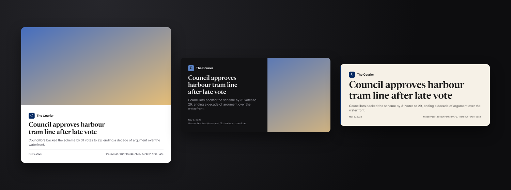
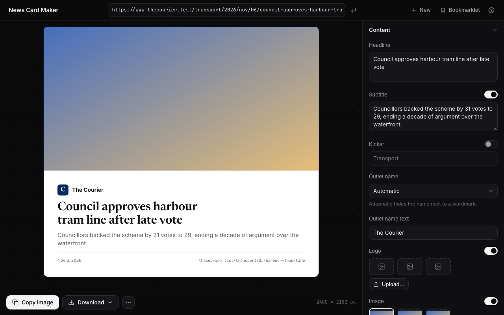

# News Card Maker

Turn a news link into a clean, citable card for your slides. Paste an article URL, tweak the card, and
copy a PNG to the clipboard. Think [carbon.now.sh](https://carbon.now.sh), but for headlines.



The cards above come from a made-up article. Nothing in this repository is a real publisher's page,
picture or logo.

## What it does

- **Reads a link the way a link preview does.** Headline, subtitle, featured image, outlet logo and brand
  colour, publication date, author and the address to cite. Only that headline-level metadata: the article
  text is never fetched, stored or shown.
- **Makes a card you can customise.** Three templates (Classic, Split, Headline), five themes (Light,
  Dark, Brand, Paper, Mono), every common size from auto-height to 16:9, 1:1 and 9:16, text that fits by
  itself, a carbon-style frame, right-to-left and CJK text, and an editor for every field.
- **Copies it as a picture.** **Copy image** puts a PNG on the clipboard (transparent rounded corners
  intact) for pasting straight into Google Slides, PowerPoint or Keynote. Download as PNG, JPEG or WebP at
  1× to 4×.
- **Still works when a site says no.** Some outlets block automated readers. A bookmarklet, pasted page
  source, a dropped `.html` file and manual entry all get you a card without going around anything.



## Using it

1. Paste an article link on the start page and press **Enter**. (`?url=` in the address also works, which
   makes it easy to wire into other tools.)
2. Click any text on the card to jump to its field, drag the picture to move its focus, or drop your own
   picture on the preview. Headline, subtitle and outlet name have an **Alternatives** menu that lists the
   other candidates found on the page, labelled by where they came from.
3. **Copy image**, or **Download** as PNG, JPEG or WebP.

| Shortcut                    | Does                      |
| --------------------------- | ------------------------- |
| `/` or `Ctrl/⌘ L`           | Focus the link field      |
| `Enter`                     | Create the card           |
| `Ctrl/⌘ V` (no field focus) | Paste a link or an image  |
| `Ctrl/⌘ C` (no text picked) | Copy the card as an image |
| `Ctrl/⌘ S`                  | Download the card         |
| `?`                         | Show the shortcuts        |

### When a site will not let the app read it

Some outlets (The Economist, the New York Times and the Financial Times among them) show bots a challenge
or a paywall instead of the page. The app never tries to get past that. It tells you, and offers three
ways forward that use what _your own browser_ can already see:

- **Bookmarklet.** Drag the bookmarklet from the app's Bookmarklet dialog to your bookmarks bar. Open the
  article normally, click the bookmark, and you land back in the app with the card ready. It works on any
  page you can open, including paywalled ones, because your browser did the reading. Only the page's
  preview details travel back (the tags a link preview reads, its main headings and dates, and its header
  logo), never the article text, inside the address of the app page, which no server receives. Some sites forbid bookmarklets with their security settings
  (Firefox is the strictest); use the next option there.
- **Paste page source.** View the page's source (`Ctrl/⌘ U`), copy everything, and paste it into the
  dialog. A saved `.html` file works too: choose it, or drop it anywhere on the page. The page address is
  found in the source when it says it.
- **Start from scratch.** Type the headline and pick an outlet from the built-in list to get its logo and
  colours.

## Privacy and third parties

There is no analytics, no tracking, no cookies, and nothing is stored in your browser. Fonts are bundled
with the app, not loaded from a font service. Here is everything that is contacted, and why:

| Who                                                            | When                                                           | What they see                                                                                                                                                                                                                     |
| -------------------------------------------------------------- | -------------------------------------------------------------- | --------------------------------------------------------------------------------------------------------------------------------------------------------------------------------------------------------------------------------- |
| **The app's host** (GitHub Pages)                              | Loading the app                                                | Your IP address and the usual request metadata, as for any website. Nothing about your cards.                                                                                                                                     |
| **The fetch proxy** (a Cloudflare Worker you or the owner run) | When you ask for a link, and for the images and logos it names | The address you asked for and the image addresses, and your IP address. It sends no cookies and keeps no URLs in its logs. It briefly caches fetched pages and images at Cloudflare's edge, shared by everyone, and nothing else. |
| **The publisher's own server**                                 | When you ask for its link                                      | One request for that page, then its declared images and logos, from the proxy with an honest `User-Agent` that names this tool.                                                                                                   |
| **Hacker News** (`hacker-news.firebaseio.com`)                 | Only when the link is a Hacker News item                       | The item number, straight from your browser (the site's own public API).                                                                                                                                                          |
| **Wikimedia Commons**                                          | When a built-in outlet's logo is hosted there                  | The logo address, through the proxy.                                                                                                                                                                                              |

The bookmarklet, pasted source and manual mode never contact the publisher at all. Features planned for
the next phase (an Internet Archive fallback, feed discovery on publishers' home pages and an optional
favicon service) will be added to this table, each with a switch to turn it off.

## Fair use, trademarks and manners

Logos identify the source of a citation; they belong to their publishers, and this project is not
affiliated with any of them. The app references publisher-hosted logo addresses instead of bundling logo
files. Headlines and the other metadata shown are what publishers expose in their pages for link
previews. The tool fetches only when you ask, one page plus the assets it declares, never crawls, never
impersonates a crawler or a browser, never sends a `Referer`, and never tries to get around a paywall or
bot protection (see "Hard rules" in [AGENTS.md](AGENTS.md)).

## Deploying (steps for the owner)

The site is static and lives on GitHub Pages. The only server is the small fetch proxy, a Cloudflare
Worker, because browsers cannot read other sites' pages. Both deploy from GitHub Actions
([`deploy.yml`](.github/workflows/deploy.yml)). Everything below is one-time setup that needs your
accounts, so nothing here can be done for you:

1. **Create the repository** on GitHub and push this code to its `main` branch. The workflow builds the
   site with the repository's name as its path, so the site ends up at
   `https://<you>.github.io/<repository>/`.
2. **GitHub Pages:** Settings → Pages → **Source: GitHub Actions**.
3. **Cloudflare:** create a free account. Create an API token from the "Edit Cloudflare Workers" template
   and note your Account ID (Workers & Pages, right-hand column).
4. **GitHub secrets and variables:** Settings → Secrets and variables → Actions.
   - Secrets: `CLOUDFLARE_API_TOKEN` and `CLOUDFLARE_ACCOUNT_ID`.
   - Variable: `PROXY_URL`, the address of the deployed Worker. You get it from the first run (next step).
5. **First run:** push (or run the **Deploy** workflow by hand). The proxy job deploys the Worker and
   prints its address (`https://news-card-proxy.<your-subdomain>.workers.dev`). The site job stops
   with a message because `PROXY_URL` is not set yet. Set it to that address and re-run the workflow.
   The proxy allows requests from `https://<you>.github.io` by default.
6. **Check it:** open the site, paste a link, copy a card. Then run **Smoke** once from the Actions tab
   for a report on a dozen real outlets.

Optional:

- **Custom domain.** Set the repository variables `BASE_PATH` to `/` and `ALLOWED_ORIGINS` to the
  site's origin (comma-separated for several). Serving the proxy on your own domain on Cloudflare also
  switches on edge caching, which Cloudflare only guarantees on custom domains.
- **One origin instead of two.** A single Worker with Static Assets can serve `web/dist` and `/api/*`
  together: one deploy and no cross-origin requests, at the cost of leaving GitHub Pages. Not built here.

The proxy deploys only when something under `proxy/` changed (or when you ask for it in the Run
workflow form). The `Smoke` workflow runs every Monday and uploads its report as an artifact.

## Self-hosting the proxy

`proxy/` is one Worker with no dependencies beyond web-standard APIs, so it can move to other edge
runtimes with little glue. Its contract (full detail in [PLAN.md §4](PLAN.md)):

| Endpoint                   | Does                                                                                                                                                                                                                                                                                                                                                       |
| -------------------------- | ---------------------------------------------------------------------------------------------------------------------------------------------------------------------------------------------------------------------------------------------------------------------------------------------------------------------------------------------------------- |
| `GET /api/text?url=<url>`  | Fetches HTML, XML or JSON (up to 3 MB; longer pages are cut and flagged `X-Truncated`) and returns the raw bytes, with `X-Upstream-Status`, `X-Upstream-Content-Type`, `X-Final-Url`, `X-Redirect-Count` and `X-Fetch-Ms`. It answers 200 even when the page's own status is 4xx or 5xx, because a challenge page's body is what the app has to recognise. |
| `GET /api/image?url=<url>` | Fetches an image (up to 15 MB), checks its type against its first bytes, and returns it. SVG is sent with a locked-down CSP.                                                                                                                                                                                                                               |
| `GET /health`              | `{ "ok": true, "version": "…" }`                                                                                                                                                                                                                                                                                                                           |

Errors are `{ "error": { "code", "message" } }`:

| HTTP      | Code                                                                | Meaning                                                                     |
| --------- | ------------------------------------------------------------------- | --------------------------------------------------------------------------- |
| 400       | `INVALID_URL`                                                       | Missing, malformed or non-http(s) target                                    |
| 403       | `FORBIDDEN_TARGET`, `ORIGIN_NOT_ALLOWED`                            | Private, loopback or reserved target; or the caller's origin is not allowed |
| 404 / 405 | `NOT_FOUND`, `METHOD_NOT_ALLOWED`                                   |                                                                             |
| 413       | `IMAGE_TOO_LARGE`                                                   | Image over the size cap                                                     |
| 415       | `NOT_TEXT`, `NOT_IMAGE`                                             | Content type or leading bytes not allowed                                   |
| 429       | `RATE_LIMITED`                                                      | Over 30 pages or 240 images per minute for one address                      |
| 500       | `INTERNAL_ERROR`                                                    | The proxy itself failed (nothing is logged about the request)               |
| 502       | `UPSTREAM_UNREACHABLE`, `UPSTREAM_HTTP_ERROR`, `TOO_MANY_REDIRECTS` | Connection failure, non-2xx image response, redirect loop                   |
| 504       | `UPSTREAM_TIMEOUT`                                                  | The publisher did not answer in 8 s (text) or 10 s (images)                 |

Configuration is in [`proxy/wrangler.jsonc`](proxy/wrangler.jsonc): `ALLOWED_ORIGINS`, `USER_AGENT`,
`MAX_TEXT_BYTES`, `MAX_IMAGE_BYTES` and the two rate-limit bindings. Hardening in short: an origin
allowlist; every redirect hop re-checked against private, loopback and reserved addresses; at most six
redirects with a per-request cookie jar that never outlives the request; byte caps; magic-byte sniffing;
no client cookies or `Referer` forwarded; and no URLs in logs.

## Development

You need Node 24 or newer (`.nvmrc` pins the version CI uses).

```bash
npm install
npm run dev          # proxy (wrangler dev) on :8787 and the web app (Vite) on :5173
```

`wrangler dev` works locally without a Cloudflare account.

| Command                             | What it does                                                               |
| ----------------------------------- | -------------------------------------------------------------------------- |
| `npm run lint` / `npm run format`   | Biome check / check with fixes                                             |
| `npm run check:html`                | Fails if `innerHTML`-style APIs appear in `web/src`                        |
| `npm run typecheck`                 | `tsc --noEmit` for web, proxy and scripts                                  |
| `npm test`                          | Vitest: web unit tests (jsdom) and proxy tests (in the Workers runtime)    |
| `npm run build`                     | Production build of the web app (`web/dist`)                               |
| `npm run e2e`                       | Playwright on Chromium, Firefox and WebKit, against a built and served app |
| `npm run smoke -- --local`          | Live run against real outlets through a local proxy (not a merge gate)     |
| `npm run registry:check -- --local` | Checks the outlet registry, and that every logo and feed URL loads         |
| `npm run inspect -- <url>`          | Prints what extraction finds on one page, through a local proxy            |
| `npm run screenshots`               | Regenerates the pictures in this README from synthetic data                |

How it fits together:

```
browser ──► web/ (static site: Vite + TypeScript, no framework)
              │  extraction runs here, in the browser
              ▼
           proxy/ (Cloudflare Worker) ──► the publisher's page and images
```

- `web/src/core`: pure extraction (JSON-LD, Open Graph, Twitter, Parse.ly, microdata and more), ranking,
  dates, URLs, blocked-page detection. No network and no globals except a `Document` passed in.
- `web/src/net`: the proxy client, the pipeline, the Hacker News adapter. `web/src/brand`: the outlet
  registry (`outlets.json`), logo and colour handling, themes with contrast guarantees.
- `web/src/render`: builds the card as DOM with a tiny `h()` helper (extracted strings only ever go in
  through text nodes). `web/src/export`: turns it into a PNG. `web/src/ui` and `web/src/state`: the editor.
- `web/src/bookmarklet`: the collector that runs on the news page, the receiver, and the build that
  bundles the collector into the bookmarklet (`generated.ts`, not committed).
- `web/dev/gallery.html`: every template × theme × size on synthetic data; the end-to-end tests render it.

Tests live next to their workspace: `web/tests/{unit,e2e,fixtures}` and `proxy/test`. Fixtures are
hand-made, synthetic pages; real pages, pictures and logos are never committed.

[PLAN.md](PLAN.md) is the full design and roadmap, [AGENTS.md](AGENTS.md) is the working summary for
people and coding agents, [docs/decisions](docs/decisions) records where the build departed from the
plan, and [docs/qa.md](docs/qa.md) lists what still needs a human with a real browser.

## Status

Phase 1 (milestones M0 to M7) is built. Automated checks cover the proxy, extraction, rendering, export,
the fallbacks and the content security policy on Chromium, Firefox and WebKit. A live run of the
extractor against real outlets is in [docs/smoke-2026-11-07.md](docs/smoke-2026-11-07.md). Not yet
verified by hand: clipboard copy in desktop Safari, Firefox and Chrome, pasting into slide software, and
the bookmarklet on a live Economist article ([docs/qa.md](docs/qa.md) has the checklist).

## Licence

MIT. Logos and headlines belong to their publishers.
